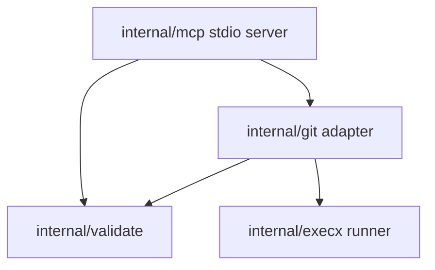

# Architecture

## Layering

- **MCP** exposes tools and protocol framing (official Go SDK). It must not spawn subprocesses directly for Git.
- **validate** enforces `repo_path`, containment, and scalar limits before paths reach Git helpers.
- **git** builds allowlisted `git` argv slices, applies shared read-only environment defaults, and interprets subprocess results (including `git diff` exit `1` as “differences present”).
- **execx** runs commands without a shell, honors context deadlines, and caps combined stdout+stderr size.

## Git adapter (`internal/git`)

### Environment

`EnvGitReadOnly()` starts from `os.Environ()` and overlays:

| Variable | Value | Purpose |
|----------|-------|---------|
| `GIT_PAGER` / `PAGER` | `cat` | Disable interactive pagers on stdio-backed runs. |
| `GIT_TERMINAL_PROMPT` | `0` | Prevent credential/auth prompts. |
| `LC_ALL` | `C` | Stable, ASCII-friendly locale for diff text. |

No other environment mutation happens inside the adapter; callers should not inject arbitrary env maps without review.

### Subprocess rules

- Always `exec.CommandContext` with an explicit argv slice (`execx.Run`). **No shell** (`sh -c`, pipes, etc.).
- Flags are chosen only from internal tables. User input is limited to path operands after a literal `--` separator for `git diff --no-index`.
- Path arguments are rejected if empty or if they begin with `-` so they cannot be mistaken for flags.

### `git diff --no-index`

Fixed construction pattern:

1. `git diff --no-index`
2. `--unified=<n>` with bounded `n` (default `3` when unset in options).
3. Optionally `--ignore-all-space` (**IgnoreWhitespaceAll**) or `--ignore-space-change` (**IgnoreWhitespaceChange**).
4. `--` then `left` and `right` paths.

### Exit code mapping

| Code | Meaning |
|------|---------|
| `0` | Success; no textual difference. |
| `1` | Success; difference present (`HadDiff=true`). |
| Other | Failure; surfaced as `errors.NonZeroExit` with stderr payload. |

`DetectGit` accepts only exit `0` and treats truncated stdout as failure.

### Timeouts and output caps

- `DetectGit`: short timeout (5s) and 64KiB cap on captured output.
- `DiffNoIndex`: configurable timeout (default 30s) and output cap (default 8MiB; `0` selects default, negative unlimited via `execx`).

Truncation sets `DiffNoIndexResult.Truncated` and returns `ErrExecTruncated`.
